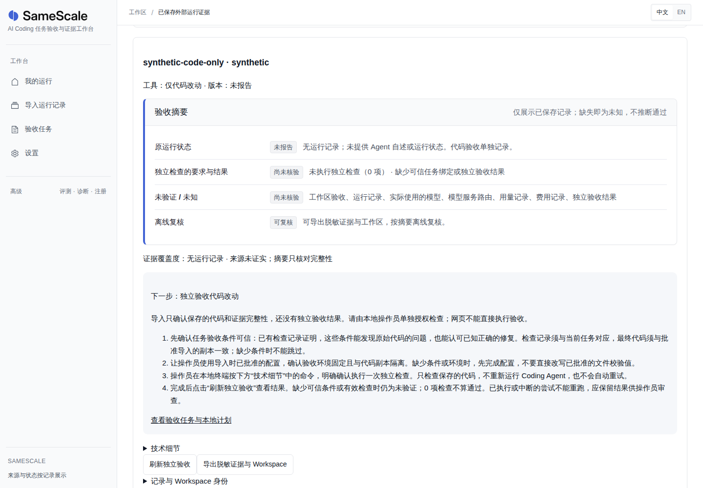

# SameScale

**AI Coding Agent 评测与验收平台** · *AI Coding Agent Evaluation & Acceptance Platform*

面向 AI Coding Agent 的工程评测与任务验收：按任务条件独立检查最终代码，区分 Agent 的完成声明与实际检查结果，并保留可追溯、可离线复核的证据。

- **[评测框架](docs/EVAL_METHODOLOGY_V2.md)**：组织任务、运行配置与验收条件，按明确的任务契约评估代码结果。
- **[隔离执行](docs/LOCAL_EXECUTION.md)**：用 Docker 隔离模拟运行与独立代码检查，分开被测代码和隐藏验收材料。
- **[结果校验](docs/EXTERNAL_RUN_EVIDENCE.md)**：由独立 Verifier 检查最终代码；未检查、零检查或缺少前置条件时保持“未验证”。
- **[证据追溯](docs/EXTERNAL_CODEX_EVIDENCE.md)**：关联运行记录、代码快照与检查结果，以摘要校验文件一致性；摘要不证明来源真实。
- **[离线回放](scripts/replay_external_evidence.py)**：校验导出证据的一致性，不重跑 Agent 或 Verifier，不构成新的验收。

**当前边界：产品内真实 Codex 执行默认关闭（当前由代码门禁禁用）；网页没有一键验收，独立检查需操作员在本地终端单独授权；不支持 Cursor / DeepSeek 原生运行记录格式，可仅导入最终代码与任务条件。**

**真实评测（有效运行25题）：Agent 自报通过25/25（100%），独立验收通过23/25（92%）；虚假完成2次（8%，自报 PASS 但独立 FAIL）。**

评测条件：**2026-10-14（UTC）**，外部 **Codex CLI 0.162.1**，请求模型 **gpt-6.1-sol / high**；固定题集 **25题 SWE-bench Verified + 5题 HumanEval**，每题至多一次 Agent 运行。
有效运行主口径仅排除5题环境失败，包含20题 SWE 与5题 HumanEval。原30题口径、环境失败明细及样本局限完整保留在[评测报告](https://github.com/a27497/samescale/blob/6854e528769920a255ae3574095acf0c47f3baeb/docs/evidence/swe-full-20261014/README.md)（[PR #21](https://github.com/a27497/samescale/pull/21)）；“虚假完成”不推断欺骗意图。这次外部评测不改变产品内 REAL_CODEX 的关闭状态。

## Agent 说完成了，验收依据在哪里？



*真实产品界面（1440px），使用合成的仅代码输入；没有运行记录，独立检查尚未进行，结果保持未验证。*

AI Coding Agent 的“完成了”是一条声明。验收依据需要来自最终代码、明确的任务条件和独立检查。
SameScale 把这些材料关联起来，让开发者看到**哪些要求已检查、哪些失败、哪些仍然未知**，并保存可离线复核的证据。

这是一个个人工程项目。
[官网与案例说明](https://getsamescale.com/) · [只读在线演示](https://getsamescale.com/demo/) · [能力契约](PUBLIC_PRODUCT_CONTRACT.md)

## 核心能力

必需输入是**最终代码目录与任务要满足的条件**；运行记录是可选的补充材料。

| 能力 | 当前实现 |
| --- | --- |
| 导入多工具证据 | 支持 Codex 的四种既有格式、Claude Code 的 stream-json 记录，以及任意 Coding Agent 的仅代码导入。所有输入都要经过人工批准，核对文件没有偏离批准时的版本，并检查访问权限与敏感信息。 |
| 查看验收摘要 | 分开展示原运行状态、Agent 自述、独立代码检查和缺失信息。没有运行记录时标注“无运行记录”，未检查的要求保持“未验证”。 |
| 独立验收代码 | 由操作员在本地终端单独授权，使用已审查并验证有效的任务条件，以及版本已固定、与代码隔离的检查环境，检查保存的代码。检查条件需先证明能发现原始代码的问题、认可已知正确的修复；网页只提供操作说明，不能授权执行。 |
| 保存与离线复核 | 导出经过筛选的材料，用保存的文件校验值确认仍是同一份记录、代码和已有检查结果。复核不会再次运行 Agent 或代码检查，也不构成一次新的验收。 |

典型流程：**准备代码与条件 → 人工审查并批准 → 导入 → 查看摘要 → 准备好检查条件后单独授权验收 → 导出复核**。
导入成功、进程退出成功和 Agent 的完成声明，都不能代替任务验收通过。

产品内不预置示例数据。案例 A 等历史证据复盘见[官网](https://getsamescale.com/)；官网演示使用单独的只读材料，不能当作新导入或新验收的结果。

## 本地启动

需要 Git、**Python 3.12.14、uv 0.12.5**，以及已启动的 Docker Engine / Docker Compose v2。
前端与后端镜像按仓库锁定依赖构建，宿主无需另装 Node.js。首次启动需要下载依赖和基础镜像，**不需要模型 API Key**。

在 Bash 中执行：先确认下面两个端口未占用；已有服务的机器请更换空闲端口，项目名也不要复用。

```bash
git clone --branch main https://github.com/a27497/samescale.git
cd samescale
uv sync --locked

# 全新项目名隔离数据库和数据卷；端口仅绑定到本机。
export SS_PROJECT="samescale-local-$(date +%s)-$$"
export HARNESSLAB_PORT=48690
export POSTGRES_PORT=48691

uv run --locked harnesslab up --project-name "$SS_PROJECT"
uv run --locked harnesslab status --project-name "$SS_PROJECT"
uv run --locked harnesslab doctor --project-name "$SS_PROJECT"
```

打开 **[http://127.0.0.1:48690/](http://127.0.0.1:48690/)**，应进入“我的运行”首页，显示“还没有运行记录”。
[健康检查](http://127.0.0.1:48690/api/health)会检查数据库连接。
启动流程创建该项目的 PostgreSQL，自动执行 `alembic upgrade head`，再启动 FastAPI 与构建后的 Vue 页面；不执行 Agent、模型或任务验收。

标准启动只提供工作台，**不会自动启用私有证据导入**。要导入自己的材料，按[首次私有接入指南](docs/EXTERNAL_EVIDENCE_QUICKSTART.md)配置独立的操作员口令、批准策略、代码与任务绑定；现有 Compose API 不转发这些设置或挂载批准来源。

停止本次项目，保留数据卷；再次启动时使用同一个项目名：

```bash
uv run --locked harnesslab down --project-name "$SS_PROJECT"
```

端口冲突、Docker 不可用或检查失败时，按[安装与故障排查](docs/PRODUCTIZATION.md)处理。
默认数据库口令仅用于本地开发，请勿用于生产；不要复用已有服务的 `.env`、数据库或模型凭据。

## 工程可靠性设计

- **验收权威分离。** 确定性检查、人工标注和模型判断保留各自权威。原运行与事后检查分别保存；后来的审计不会回填原运行成绩，Agent 自述不提升为验收结论。
- **缺失与损坏明确可见。** `NOT_RUN`（未运行）、`NOT_VERIFIED`（未验证）和 `CORRUPT`（损坏）保留独立含义。零检查、缺少前置条件、摘要不一致或关键检查跳过不能建立通过结论。
- **固定身份，保留未知。** 代码、任务条件与证据摘要绑定；旧 Codex 记录身份继续可读。工具差异由转换器处理，缺失的版本、退出码与用量不猜测补齐；摘要校验不等于来源认证，来源未证实时保留 `NOT_ATTESTED`。
- **权限与执行隔离。** 只读取用户主动提供且人工批准的文件，不扫描本地会话目录。Verifier 与代码工作区隔离，隐藏验收材料不交给被验代码；API 容器不挂载 Docker socket。
- **副作用受控。** 本地任务计划的确认不等于执行授权；独立 Worker 的执行另行确认。已有 Fake 路径使用隔离容器，不调用模型；中断后保留证据，不自动重跑已消耗的尝试。
- **回归可以脱离模型。** 自动 CI 检查证据读取、安全边界和前端契约；每个 PR 跑完整自动回归，离线回归隔离网络、核对固定输出并重复复核。[CI 范围与调度](docs/CI_FEEDBACK.md)记录具体保护和限制。

技术栈：**Python / FastAPI / PostgreSQL / SQLAlchemy / Alembic / LangGraph / Vue 3 / TypeScript / Docker / GitHub Actions**。
沿用 `src/harnesslab`、`harnesslab` CLI 和 `HARNESSLAB_*` 配置名，保留实现与历史兼容性。

## 边界与未覆盖项

- **工具接入范围：** Cursor / DeepSeek 自身格式的运行记录，目前还不能直接读取；可以只提供最终代码与任务条件。自动识别只限用户主动提供的 Codex / Claude 逐行 JSON 运行记录，不会查找本机保存的会话。
- **代码输入范围：** 只导入 UTF-8 文本形式的最终代码目录，不会自动把代码补丁应用到原始版本，也不支持任意二进制文件或大仓库上传；任务条件必须另行审查，并与这次导入对应。
- **验收前提：** 任意一段文字需求不会自动变成可信的检查。缺少已批准并验证有效的任务检查、版本已固定的检查镜像或独立检查结果时，仍然显示“未验证”；网页没有“一键执行验收”的权限。
- **验证范围：** 多工具导入与 PostgreSQL 相关的完整流程、各环节的故障恢复与生产部署，尚未完成整体验收。部分场景测试通过、服务能启动，不代表这些流程都已验收。
- **真实运行：** 产品内本地执行只开放不调用模型的隔离模拟运行，REAL_CODEX 保持关闭。本次评测在产品外直接运行 Codex CLI；没有验证 Cursor / DeepSeek 新的真实会话或连接不同工具账号的通用能力。已保存的评测与历史记录，只能支持当时实际观察到的结论。
- **来源与结论：** 自动敏感信息检查不能代替人工审查隐私和版权；没有核实来源真实性的材料会标注“来源未证实”。部分检查、离线复核或描述性的运行差异，不能据此断定因果关系或给模型排名。

## 技术文档与实现说明

| 想了解什么 | 入口 |
| --- | --- |
| 输入如何转换、批准、保存 | [运行证据输入契约](docs/EXTERNAL_RUN_EVIDENCE.md) · [私有接入指南](docs/EXTERNAL_EVIDENCE_QUICKSTART.md) |
| 架构与验收权威如何划分 | [架构](docs/ARCHITECTURE.md) · [方法与可比性](docs/EVAL_METHODOLOGY.md) |
| 任务计划与执行如何隔离 | [本地任务计划](docs/LOCAL_PLANNING.md) · [独立 Worker 执行边界](docs/LOCAL_EXECUTION.md) |
| 测试实际证明了什么 | [多工具导入验收记录](docs/qa/agent-neutral-intake-20261012/README.md) · [界面与隔离 Verifier 验证](docs/qa/agent-neutral-ux-20261011/README.md) |
| 当前冻结状态与对外承诺 | [当前里程碑](CURRENT_MILESTONE.md) · [公开产品契约](PUBLIC_PRODUCT_CONTRACT.md) |

## 许可

主产品源码采用 [Apache License 2.0](LICENSE)。[许可范围](LICENSE_SCOPE.md)、[品牌资产](BRAND_ASSETS.md)与[第三方义务](THIRD_PARTY_NOTICES.md)单独说明；源码许可证不自动授权 Logo、历史材料或外部内容。
